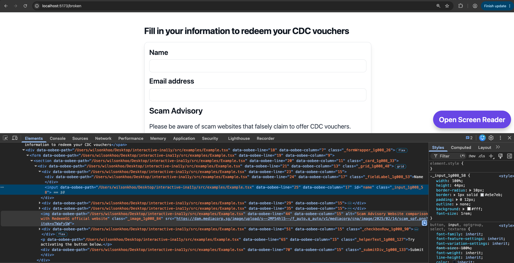
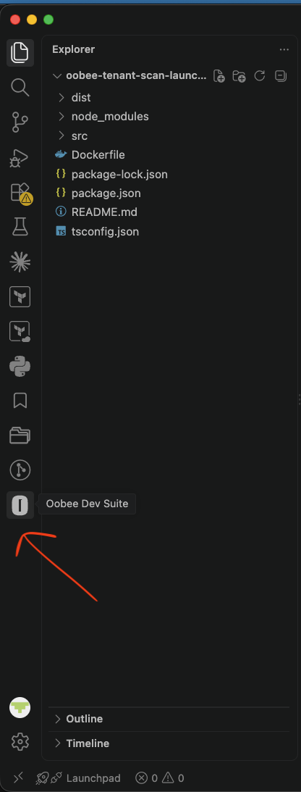

# 🧬 oobee-genome

Automatic source location tracking for DOM elements across multiple build tools.


## 🎯 What This Guide Solves

1. Install `@govtechsg/oobee-genome` from npm.
2. Pick your framework/build tool and wire it up quickly.
3. Keep production deployments clean by using a separate dev-only build config.


## 2. 📦 Installation

```bash
npm install @govtechsg/oobee-genome
```


<h3 style="color: red;">⚠️ Do Not Ship oobee-genome to Production</h3>

> [!CAUTION]
> **@govtechsg/oobee-genome is for development/debugging only. Never ship it in production builds.**
>
> Keep this in mind throughout the setup:
> - Your **production config** (`vite.config.js`, `next.config.js`, etc.) must never include oobee.
> - Always create a **separate** dev-only config file (e.g. `vite.config.oobee.ts`, `webpack.config.oobee.js`, `next.config.oobee.js`).
> - Use `npm run dev:oobee` for local debugging, and `npm run build` for all production builds.

#### Built-in safeguards

The adapters also refuse to inject outside development, as a backstop in case a dev config is used by mistake:

| Adapter | Injects only when |
|---|---|
| Vite | Running the dev server (`apply: 'serve'`) with `NODE_ENV=development` (the dev server sets this itself when unset) |
| Next.js | `NODE_ENV=development` **and** webpack reports a dev build |
| Webpack, Angular | webpack `mode` is `development` (e.g. `--mode development`) and `NODE_ENV` is not `production` |
| Rollup, esbuild | `NODE_ENV=development` |

All adapters stay disabled whenever `CI` or `CONTINUOUS_INTEGRATION` is set to anything other than empty, `false` or `0` (any casing), `VERCEL_ENV` is `production` or `preview`, or `NEXT_PHASE` is a production phase, even in development. To inject into a local production-mode Rollup/esbuild build anyway, set **both** `OOBEE_DNA_FORCE=1` and `OOBEE_DNA_FORCE_ACK=i-understand-this-leaks-paths`. The CI/Vercel/Next signals still win over this override, and a webpack `production`/`none` build never injects.

Other guarantees:

- Component library elements (MUI, Vuetify, local components) are tagged too: the attributes are passed as props and land on the component's root DOM node. Wrappers that render no element (`Fragment`, `Suspense`, `StrictMode`, context `Provider`/`Consumer`, Vue `<template>`/`<slot>`/`<transition>`) are always skipped. Use the `blacklist` option to skip additional tag or component names.
- `data-oobee-path` is **project-relative** (e.g. `src/App.tsx`), resolved against `pathRoot` or, by default, the directory the build runs in. Your username and absolute directory layout are never embedded. Files outside that root are reduced to their file name.
- File names are escaped for each output context (HTML/JSX attributes, JavaScript strings), so a file named e.g. `x" onload="….tsx` cannot inject markup or code.
- `attributePrefix` must be a plain attribute name (letters, digits, `-`); anything else throws.
- Line/column lookups are linear in file size, so very large files do not stall the dev server.

### What gets tagged

Every element that renders into the DOM is tagged, whether it comes from raw HTML, a component library (MUI, Vuetify, ...) or your own components.

| Source | Tagged |
|---|---|
| JSX host tags and components (`<div>`, `<Button>`, `<Select.Item>`) | Yes |
| `React.createElement('div' \| Component, props)` and `document.createElement('div')` | Yes |
| HTML files and Vue templates (elements and components) | Yes |
| React `Fragment` / `<>`, `Suspense`, `StrictMode`, `Profiler`, `Provider`, `Consumer` | No: they render no element |
| Vue `<template>`, `<slot>`, `<teleport>`, `<keep-alive>`, `<suspense>`, `<transition>`, `<transition-group>` | No: they render no element |

The attributes are passed to a component as props, so they land on the component's **root** DOM node. Use `blacklist: ['Name']` to skip extra tag or component names.

### Library-rendered child elements

Component libraries create extra DOM that never appears in your source (MUI's `<input>`, `<label>`, ripple `<span>`; Vuetify internals). A build step cannot tag those, so `oobee-genome` adds a small browser step:

- Each untagged element copies `data-oobee-path`, `-line` and `-column` from its **nearest tagged ancestor**, and gets `data-oobee-inherited="true"`. It points at the component you wrote, since that is the closest source location.
- The transform appends one import line to the end of each transformed module (line numbers and `'use client'` are unaffected). It is added only in development, like the rest of the injection.
- Elements added later, such as dialogs, are tagged as they appear.
- The first pass waits for the page to settle (about 0.5 s of no DOM changes, 8 s at most) so server-rendered frameworks such as Next.js finish hydrating first. **Scan after the page has settled.**
- Elements with no tagged ancestor, for example a portal attached to `<body>`, stay untagged.
- Turn it off with `inheritChildren: false`.

### Options

| Option | Default | Description |
|---|---|---|
| `includePatterns` | `[/\.(ts\|tsx\|js\|jsx\|vue\|html)$/]` | Files to transform |
| `excludePatterns` | `node_modules`, `*.d.ts`, `*.spec/test.(tsx\|jsx)` | Files to skip |
| `blacklist` | `[]` | Extra tag or component names to skip. Non-DOM wrappers (`Fragment`, ...) are always skipped |
| `attributePrefix` | `'data-oobee'` | Attribute name prefix |
| `pathRoot` | `'.'` | Directory emitted paths are relative to |
| `inheritChildren` | `true` | Tag library-rendered children in the browser |
| `enabled` | `true` | Turn the injection on or off |
| `verbose` | `false` | Log each transformed file |


### Using the Oobee Dev Suite VS Code extension

Install the Oobee Dev Suite extension, open your application's folder in VS Code,
and scan your local development URL.

For example, suppose your folders look like this:

```text
my-repository/                 ← folder opened in VS Code
└── frontend-app/
    ├── next.config.oobee.js
    └── app/
        └── page.tsx
```

In `frontend-app/next.config.oobee.js`, point `pathRoot` one folder up:

```js
const path = require('path');
const { withOobeeDNA } = require('@govtechsg/oobee-genome/adapters/next');

module.exports = withOobeeDNA({}, {
  pathRoot: path.resolve(__dirname, '..') // my-repository/
});
```

Genome now injects `data-oobee-path="frontend-app/app/page.tsx"`. Dev Suite joins
that path with the open `my-repository` folder to find your file.

If you open `frontend-app` itself in VS Code instead, omit `pathRoot`; Genome
uses the folder where you start the dev server and injects `app/page.tsx`.

## 3. 🛠️ Choose Your Framework / Build Tool

Select your framework below. Click to expand and follow the step-by-step setup.

**Available frameworks:**

- Vite (React, Vue)
- Webpack (React, Vue)
- Next.js

<details>
<summary><strong>Vite (React, Vue)</strong></summary>

### ⚡ Vite (React, Vue)

<span style="color: red; font-size: 1.1em;">**Important:** Always use `npm run build` for production. It uses the original `vite.config.ts`, never the oobee config.</span>

**Setup in 3 steps:**

**Step 1: Install**

```bash
npm install @govtechsg/oobee-genome
```

**Step 2: Create dev-only config**

Copy your existing `vite.config.ts` (or `.js`) to `vite.config.oobee.ts`, then add the oobee plugin:

```ts
import { defineConfig } from "vite";
import { oobeeVitePlugin } from "@govtechsg/oobee-genome/adapters/vite";
import react from '@vitejs/plugin-react'

export default defineConfig({
  plugins: [oobeeVitePlugin({ verbose: true }), react()],
});
```

**Step 3: Update package.json scripts**

Add these scripts to your `package.json`:

```json
{
  "scripts": {
    "dev:oobee": "vite --config vite.config.oobee.ts"
  }
}
```

**Run dev with oobee enabled:**

```bash
npm run dev:oobee
```

</details>

<details>
<summary><strong>Webpack (React, Vue)</strong></summary>

### 📦 Webpack (React, Vue)

<span style="color: red; font-size: 1.1em;">**Important:** Always use `npm run build` for production. It uses the original `webpack.config.js`, never the oobee config.</span>

**Setup in 3 steps:**

**Step 1: Install**

```bash
npm install @govtechsg/oobee-genome
```

**Step 2: Create dev-only config**

Copy existing `webpack.config.js` to `webpack.config.oobee.js`, then add the oobee loader rule:

```js
module.exports = {
  module: {
    rules: [
      {
        test: /\.[jt]sx?$/,
        exclude: /node_modules/,
        enforce: "pre",
        use: [
          {
            loader: require.resolve("@govtechsg/oobee-genome/adapters/webpack"),
            options: { verbose: true },
          },
        ],
      },
    ],
  },
};
```

**Step 3: Update package.json scripts**

Add these scripts to your `package.json`:

```json
{
  "scripts": {
    "dev:oobee": "webpack serve --mode development --config webpack.config.oobee.js"
  }
}
```

**Run dev with oobee enabled:**

```bash
npm run dev:oobee
```

</details>

<details>
<summary><strong>Next.js</strong></summary>

### ▲ Next.js

<span style="color: red; font-size: 1.1em;">**Important:** Never commit `next.config.js` changes that include oobee. Your production builds must always use the original config.</span>

> [!IMPORTANT]
> The Next.js adapter hooks webpack. Next.js 16 uses Turbopack by default, which ignores it, so run `next dev --webpack`.

**Setup in 3 steps:**

**Step 1: Install**

```bash
npm install @govtechsg/oobee-genome
```

**Step 2: Create dev-only config**

Copy your existing `next.config.js` to `next.config.oobee.js` and wrap your config with the oobee plugin:

```js
const { withOobeeDNA } = require("@govtechsg/oobee-genome/adapters/next");

const nextConfig = {
  reactStrictMode: true,
};


module.exports = withOobeeDNA(nextConfig, {
  verbose: true,
  enabled: true,
});

```

**Step 3: Update package.json scripts**

Add this script to your `package.json`:

```json
{
  "scripts": {
    "dev:oobee": "cp next.config.oobee.js next.config.js && next dev --webpack"
  }
}
```

**Run dev with oobee enabled:**

```bash
npm run dev:oobee
```

**After debugging:**
After you're done with local analysis/debugging, restore your original `next.config.js`:

```bash
git checkout next.config.js
```

or copy it from your version control.

</details>

<details>
<summary><strong>Vanilla HTML/CSS/JS (No Framework)</strong></summary>

### 🌐 Vanilla HTML/CSS/JS (No Framework)

For pure HTML/CSS/JavaScript projects. **Two approaches available:**


#### 📋 Approach 1: Copy-Paste Script (Simplest - No npm/Node Required)

Perfect for **static HTML, PHP, static site generators**, or any non-Node project.

**Step 1: Copy the injector script**

Download or copy `oobee-injector.js` from this repo into your project:

```bash
# Option A: Copy from @govtechsg/oobee-genome repo
cp node_modules/@govtechsg/oobee-genome/oobee-injector.js your-project/

# Option B: Or download directly
# Visit: https://raw.githubusercontent.com/oobee/oobee-genome/main/oobee-injector.js
```

**Step 2: Add to your HTML**

Add this line before closing `</body>`:

```html
<!DOCTYPE html>
<html>
<head>
  <title>My Project</title>
  <link rel="stylesheet" href="styles.css">
</head>
<body>
  <!-- Your content here -->
  
  <script src="oobee-injector.js"></script>
</body>
</html>
```

The injector only runs (and only exposes `window.OobeeGenome`) on `file://`, `localhost`, loopback, and `*.localhost`. To use it on another dev host such as a LAN IP, opt in on the script tag: `<script src="oobee-injector.js" data-oobee-allow-host></script>`.

**Step 3: Done!**

- Open your HTML file in a browser (works with `file://` protocol)
- Open DevTools (F12) and inspect any element
- Look for `data-oobee-*` attributes ✅


**What gets injected:**

Each element receives:
- `data-oobee-file` - Current page URL
- `data-oobee-element` - Element selector (tag#id.class)
- `data-oobee-index` - Position in DOM
- `data-oobee-timestamp` - ISO timestamp

**Works with dynamic elements:** The script watches for new elements added via JavaScript and automatically injects attributes.


#### 🔨 Approach 2: NPM + esbuild Build (For Node Projects)

For projects with `package.json` and a build process.

**Step 1: Install**

```bash
npm install --save-dev esbuild @govtechsg/oobee-genome
```

**Step 2: Create dev build script**

Create `build.oobee.mjs`:

```js
import esbuild from 'esbuild';
import fs from 'fs';

// Copy injector to dist
fs.copyFileSync(
  'node_modules/@govtechsg/oobee-genome/oobee-injector.js',
  'dist/oobee-injector.js'
);

// Bundle JavaScript
await esbuild.build({
  entryPoints: ['src/index.js'],
  bundle: true,
  outdir: 'dist',
  sourcemap: true
});

// Copy HTML and CSS
fs.copyFileSync('src/index.html', 'dist/index.html');
fs.copyFileSync('src/styles.css', 'dist/styles.css');

console.log('✅ Build complete with oobee-genome!');
```

**Step 3: Update package.json scripts**

```json
{
  "scripts": {
    "dev": "npx http-server src -p 8080 -o",
    "build": "npm run build:prod",
    "build:prod": "esbuild src/index.js --bundle --outdir=dist"
  }
}
```

**Step 4: Run dev with oobee**

```bash
npm run dev
```

Then:
1. Open http://localhost:8080
2. Open DevTools (F12)
3. Inspect elements → see `data-oobee-*` attributes

**For production:** Use `npm run build` which builds without oobee.


#### 🤔 Which Approach to Use?

| Approach | Use When | Pros | Cons |
|----------|----------|------|------|
| **Copy-Paste Script** | Static HTML, PHP, no build process | Simple, no npm, works anywhere | Manual script management |
| **NPM + esbuild** | Node project with build process | Automated, integrated, sourcemaps | Requires Node.js |

**Both approaches support:**
- ✅ Adding injector via script tag
- ✅ Watching dynamic elements
- ✅ Full console API
- ✅ Works with `file://` protocol
- ✅ Easy to remove for production


</details>


## 4. ✅ After Setup: Checklist

Once you've set up oobee-genome, verify your workflow:

- [ ] You have a dev-only config file (`vite.config.oobee.ts`, `webpack.config.oobee.js`, etc.)
- [ ] Your `package.json` has both `dev` and `dev:oobee` scripts
- [ ] `npm run dev:oobee` starts dev server with @govtechsg/oobee-genome enabled
- [ ] Your local page contains `data-oobee-*` attributes when inspected in browser DevTools
- [ ] You can scan the local URL from the Oobee Dev Suite VS Code extension
- [ ] `npm run build` uses your original production config (without @govtechsg/oobee-genome)
- [ ] You never commit dev config files or changes to production configs

### Verify DNA Attributes on Localhost

Before starting a scan, confirm that oobee-genome is actually injecting source-location metadata into your running local app.

1. Start your dev server with the oobee config:

   ```bash
   npm run dev:oobee
   ```

2. Open the local URL in your browser, for example:

   ```text
   http://localhost:5173
   ```

3. Open browser DevTools, go to the **Elements** tab, and inspect an element from your page.

4. Confirm the element contains attributes like these:

   ```html
   <input
     data-oobee-path="src/App.tsx"
     data-oobee-line="25"
     data-oobee-column="17"
   />
   ```

   You should see:

   - `data-oobee-path`: the source file path, relative to the project root
   - `data-oobee-line`: the original source line number
   - `data-oobee-column`: the original source column number

   

5. After confirming the attributes are present, return to your code editor, open the **Oobee Dev Suite** VS Code extension, and run a render scan against the same local URL.

   

**Rule:** If you see @govtechsg/oobee-genome in your built/deployed code, you used the wrong config. Always use `npm run build` for production.

---

## 5. 🔧 Troubleshooting

**Problem:** `npm install @govtechsg/oobee-genome` fails with auth error

- **Solution (Internal):** Re-run `aws codeartifact login` (token may have expired)
- **Solution (External):** Ensure you're using the public npm registry

**Problem:** oobee not activating when I run `npm run dev:oobee`

- **Solution:** Check that your dev config file exists and imports oobee adapter correctly
- **Solution:** For Webpack, Rollup, esbuild and Angular, make sure `NODE_ENV=development` is set and `CI` is not. These adapters stay disabled otherwise (see *Built-in safeguards*)

**Problem:** I get `invalid attributePrefix`

- **Solution:** Use a plain attribute name such as `data-oobee` or `data-myapp`, with no quotes, spaces or punctuation other than `-`

**Problem:** Next.js shows no `data-oobee-*` attributes

- **Solution:** Run `next dev --webpack`. Next.js 16 defaults to Turbopack, which does not run the webpack loader

**Problem:** A MUI / Vuetify component's inner `<input>` or `<label>` has no attributes

- **Solution:** Wait about a second after load, since the browser step runs once the page settles. Check `inheritChildren` has not been set to `false`. Inner elements get the attributes of the component you wrote and are marked `data-oobee-inherited="true"`

## 6. 🧪 Development

```bash
npm install
npm test               # node:test suites in test/: injection, escaping, paths, performance, dev-only gates, adapters, browser runtime
npm run test:coverage  # same, and fails below 99% lines / 90% branches / 95% functions
```

The browser step is tested in jsdom, so `npm install` also pulls in `jsdom` as a dev dependency.

**Problem:** I accidentally built with the oobee config

- **Solution:** Delete `next.config.js` (if Next.js) or any symlinked configs, restore originals from git, then rebuild
